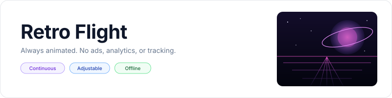
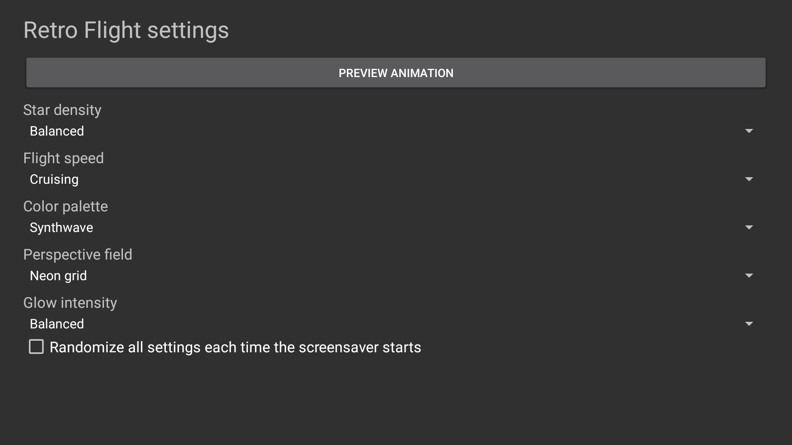

<p align="center">
    <picture>
        <source media="(prefers-color-scheme: dark)" srcset="art/banner-dark.svg">
        <source media="(prefers-color-scheme: light)" srcset="art/banner-light.svg">
        
    </picture>
</p>

<p align="center">An animated retro sci-fi flight screensaver for Fire TV, Android TV, and Google TV.</p>

<p align="center">
    <a href="https://github.com/jeremykenedy/retro-flight/releases"></a>
    <a href="https://github.com/jeremykenedy/retro-flight/releases"></a>
    <a href="https://github.com/jeremykenedy/retro-flight/actions/workflows/ci.yml"></a>
    <a href="https://github.com/jeremykenedy/retro-flight/actions/workflows/style.yml"></a>
    <a href="https://github.com/jeremykenedy/retro-flight/actions/workflows/docs.yml"></a>
    <a href="https://github.com/jeremykenedy/retro-flight/actions/workflows/security.yml"></a>
    <a href="LICENSE"></a>
    <a href="https://github.com/jeremykenedy"></a>
    <a href="https://github.com/jeremykenedy/retro-flight" title="Open the repository and click Star"></a>
    <a href="https://github.com/jeremykenedy/retro-flight/stargazers"></a>
    <a href="https://github.com/sponsors/jeremykenedy"></a>
</p>

Show some love by starring this repository on GitHub.

## Table of contents

- [Privacy](#privacy)
- [Features](#features)
- [Requirements](#requirements)
- [Installation](#installation)
- [Fire TV Toolkit](#fire-tv-toolkit)
- [Configuration](#configuration)
- [Screenshots](#screenshots)
- [Device verification](#device-verification)
- [Release notes](#release-notes)
- [Building and testing](#building-and-testing)
- [Documentation](#documentation)
- [License](#license)

## Privacy

The app has no `INTERNET` permission and makes no network requests. It contains no ads, analytics, telemetry, crash reporting, tracking, or reporting code. Settings remain on the device. The separate installer contacts GitHub only when you run it to retrieve a release APK and checksum; it does not send device or usage data.

## Features

- Continuous perspective flight through an original procedural star field.
- A softly moving ringed planet, glowing horizon, and optional animated neon grid.
- Four palettes, four star densities, three flight speeds, three glow levels, and an open-space field option.
- Per-setting random choices and optional full randomization at each screensaver start.
- Remote-friendly settings, a preview activity, and a validated settings-provider interface.
- Rendering pauses when the dream is not visible. No video decoding or runtime dependencies.

## Requirements

- Android 6.0 (API 23) or newer with DreamService support.
- ADB for installation from a computer.
- Android SDK platform 36 and build-tools 36.0.0 for local builds.

An Android TV emulator (Android 12/API 31, 1920x1080) was tested, including DreamService test activation. Fire TV hardware and physical Google TV hardware have not been tested. See [device verification](docs/VERIFICATION.md) for details and requests for testers.

## Installation

Connect the TV to the same network as the computer, enable ADB debugging, and run:

```bash
python3 install.py --serial TV_IP:5555
```

The installer retrieves the latest signed release and verifies its SHA-256 checksum before installation. It installs or updates the app but does not change system screensaver selection, sleep timers, or system update settings. Select Retro Flight in your device's screensaver or ambient display settings. See [installation and removal](docs/INSTALLATION.md) for manual, scripted, update, and uninstall flows.

## Fire TV Toolkit

[Fire TV Toolkit](https://github.com/jeremykenedy/fire-tv-toolkit) provides a guided screensaver install, update, removal, and selection flow, plus Fire TV tools for sleep and screensaver timeouts, screensaver safeguards, launcher/Home behavior, and restoring device changes. It targets Fire TV; behavior on Android TV and Google TV depends on each device and has not been established by this app's emulator tests.

Clone the toolkit and run its setup:

```bash
git clone https://github.com/jeremykenedy/fire-tv-toolkit.git
cd fire-tv-toolkit
node setup.js
```

After setup, install Retro Flight and select it:

```bash
firetv-screensavers --install=retro-flight --yes
screensaver --set=retro-flight
```

Repeat `firetv-screensavers --install=retro-flight --yes` to install a later release over the current copy. Remove it with `firetv-screensavers --uninstall=retro-flight --force`; the `--force` flag is required for non-interactive removal. Review the Toolkit's [current command reference](https://github.com/jeremykenedy/fire-tv-toolkit/blob/main/docs/COMMANDS.md) before applying its separate device-management options.

## Configuration

Open Retro Flight from the TV launcher and use the remote to adjust settings. Values persist locally and apply the next time the screensaver starts. Each choice supports a random option, and global randomization chooses all settings again at each start. See [configuration](docs/CONFIGURATION.md) for the defaults and provider schema.

## Screenshots

<p align="center">
    
    
</p>

These images are captured from the running app after the animation has settled. Capture device and settings are listed in [verification](docs/VERIFICATION.md).

## Device verification

| Platform | Result |
|---|---|
| Android TV emulator, API 31, 1920x1080 | App installation, settings screen, animation preview, DreamService start, settings provider read/write, and screenshot capture verified. |
| Physical Fire TV | Not tested. We are looking for a Fire TV owner to test installation, screensaver selection and activation, and remote settings, then report the device model, Fire OS/API, resolution, and results in the [issue tracker](https://github.com/jeremykenedy/retro-flight/issues). |
| Physical Android TV | Not tested. We are looking for an Android TV owner to test installation, screensaver selection and activation, and remote settings, then report the device model, Android version/API, resolution, and results in the [issue tracker](https://github.com/jeremykenedy/retro-flight/issues). |
| Physical Google TV | Not tested. We are looking for a Google TV owner to test installation, screensaver selection and activation, and remote settings, then report the device model, Android version/API, resolution, and results in the [issue tracker](https://github.com/jeremykenedy/retro-flight/issues). |

Emulator results do not establish vendor menu integration, physical-TV 4K composition, long-term thermal behavior, or Fire OS idle-start behavior. This project does not claim those have been tested.

## Building and testing

```bash
bash build.sh
bash test.sh
bash scripts/test-python-coverage.sh
bash scripts/test-coverage.sh
```

The host tests verify settings resolution and provider validation with 100% line and branch coverage. Installer logic also has a 100% line and branch coverage gate. Android framework lifecycle and drawing code are checked by APK inspection and emulator tests, not included in the host logic percentage. See [testing](docs/TESTING.md), [building](docs/BUILDING.md), and [architecture](docs/ARCHITECTURE.md).

## Documentation

- [Installation and removal](docs/INSTALLATION.md)
- [Configuration and host settings](docs/CONFIGURATION.md)
- [Building from source](docs/BUILDING.md)
- [Architecture](docs/ARCHITECTURE.md)
- [Testing and coverage](docs/TESTING.md)
- [Device verification](docs/VERIFICATION.md)
- [Continuous integration](docs/CI.md)
- [Troubleshooting](docs/TROUBLESHOOTING.md)
- [Release process](docs/RELEASING.md)

## Release notes

- [Version 1.0.0](docs/releases/v1.0.0.md)

## License

Retro Flight is licensed under the [Apache License, Version 2.0](LICENSE). See [NOTICE](NOTICE) for project notices.
